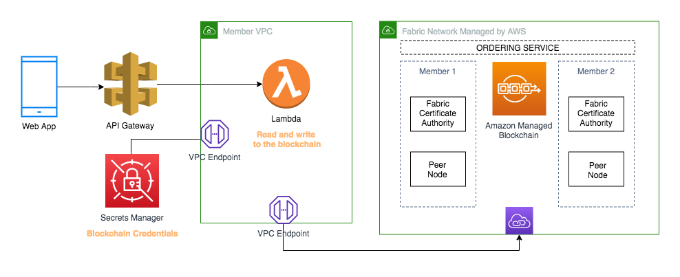

# Part 3: Read and write to the blockchain with Amazon API Gateway and AWS Lambda

Part 3 will show you how to publish a REST API with API Gateway and Lambda that invokes chaincode on a Hyperledger Fabric blockchain network running on Amazon Managed Blockchain.  You will use the NodeJS Hyperledger Fabric SDK within the Lambda function to interface with the blockchain.

## Pre-requisites
 There are multiple parts to this demo.  Before starting on Part 3, you should have completed [Part 1](../patient-clinical-exams/healthcare-fabric/README.md)

## Step 1 Lambda Infrastructure

export FABRICUSER=$ADMINUSER-msp
export FABRICUSERPASSWORD=$ADMINPWD
export CERTS_FOLDER=~/admin-msp

aws secretsmanager create-secret --name "dev/fabricOrgs/$MEMBERNAME/$FABRICUSER/pk" --secret-string "`cat $CERTS_FOLDER/$FABRICUSER/keystore/*`" --region $REGION

aws secretsmanager create-secret --name "dev/fabricOrgs/$MEMBERNAME/$FABRICUSER/signcert" --secret-string "`cat $CERTS_FOLDER/$FABRICUSER/signcerts/*`" --region $REGION

export BUCKETNAME=`echo "ngo-fabric-lambda-$(date +%N)" | tr '[:upper:]' '[:lower:]'`
export LAMBDANAME=`echo "$NETWORKNAME-fabric-lambda" | tr '[:upper:]' '[:lower:]'`

~/bk-blockchain-demos/ngo-lambda/createLambda.sh

## Step 1 Execute Lambda functtions

aws lambda invoke --function-name $LAMBDANAME --payload "{\"fabricUsername\":\"$FABRICUSER\",\"functionType\":\"queryObject\",\"chaincodeFunction\":\"queryAllDonors\",\"chaincodeFunctionArgs\":{}}" --region $REGION /tmp/lambda-output-queryAllDonors.txt

cat /tmp/lambda-output-queryAllDonors.txt

